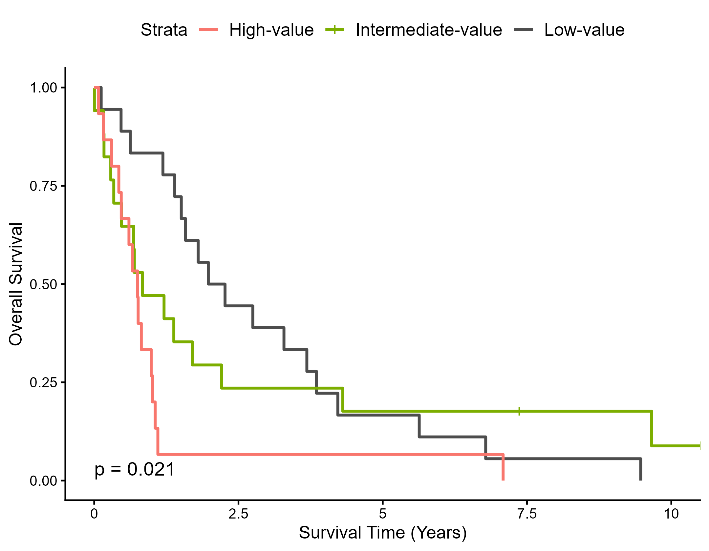

# Fig.2c 复现：PRACME 签名在 Bott 间皮瘤队列的预后验证

本仓库复现论文 **Fig.2c**——用 PRACME 评分把恶性胸膜间皮瘤 Bott 队列（GSE29354）等量三分为低/中/高危组，比较三组总生存。

> Pei L, et al. Clonal gene signatures predict prognosis in mesothelioma and lung adenocarcinoma.
> *npj Precision Oncology* (2024) · DOI: 10.1038/s41698-024-00531-y
> 作者公开代码：<https://github.com/YPeiLin/PRACME--NPJ-precision-oncology->

**复现结果**（下方左图为本次重跑所得）：log-rank **p = 0.0213**，生存曲线排序与原图一致，单因素 Cox **HR = 1.452（95% CI 1.084–1.945），p = 0.0124**。

| 本复现 | 原论文 |
|:---:|:---:|
|  | 原图见论文 Fig.2c（`data-raw/` 未收录原图，请自行对照） |

---

## 一、结果一览

| 指标 | 本复现 | 原论文 |
|---|---|---|
| 分析样本 | **50**（事件 48，占 96.0%） | 未在图中标注 |
| 分组（低/中/高） | 18 / 17 / 15 | 图形一致 |
| log-rank | χ² = 7.700，df = 2，**p = 0.0213** | 图中标注 |
| 中位生存 | 2.122 / 0.838 / 0.753 年 | 曲线走向一致 |
| 单因素 Cox（每 1 SD） | HR = **1.452**（1.084–1.945），p = **0.0124** | HR = 1.61，p = 0.013（Supplementary Table 2） |
| C-index | 0.651 | — |

量级与结论高度接近；无法逐位对齐的原因见 [第六节](#六与原论文无法逐位对齐的原因)。

> 一处如实说明的**非单调**：5 年生存率 Low 组 16.7% 略低于 Intermediate 组 17.6%。事件率已达 96%、每组仅 15–18 例，该时点估计很不稳定，不宜过度解读；但中位生存与 log-rank 均支持结论。

---

## 二、三分钟跑起来

```bash
git clone <你的仓库地址>
cd Fig2c_PRACME_repro
```

**第 1 步｜下载随访数据**（论文没有程序化接口，需手动一次）

把 Bott 等（*Nat Genet* 2011）的**补充表 18** 放到 `data-raw/`，文件名保持 `41588_2011_BFng855_MOESM18_ESM.xlsx`。
获取方式与字段说明见 [`data-raw/GET_DATA.md`](data-raw/GET_DATA.md)。

**第 2 步｜装依赖**

```r
Rscript install_deps.R
```

**第 3 步｜运行**

```r
Rscript run_all.R
```

预期屏幕输出：

```
编号配对: 53 / 53 样本
随访完整: 50 / 53
可用基因: 27 / 29  缺失: B3GALNT2, FTSJD1
n = 50    events = 48
分组: 18 / 17 / 15
log-rank chi2 = 7.700 (df=2), p = 0.02128
Cox HR(每 SD) = 1.452 (95% CI 1.084-1.945), p = 0.0124, C-index = 0.651
图已写出: output/Fig2c_KM.png / .pdf
```

> 跑过一次后 `data-raw/bott_clinical.csv` 就存在了，再跑不会重复解析 xlsx。

---

## 三、目录结构

```
Fig2c_PRACME_repro/
├── README.md
├── install_deps.R                  # 依赖安装
├── run_all.R                       # 一键复现
├── LICENSE                         # 代码 MIT
├── .gitignore                      # 排除随访数据与原始 CEL
├── data/
│   ├── PRACME_coefficients.csv     # 29 基因 + LASSO 系数（论文 Supplemental Table 1）
│   ├── gene_probe_map.csv          # GPL96 探针→基因映射（43 探针 / 28 基因，含 kept 标记）
│   └── sample_map.csv              # GSM 编号 ↔ Array sample #（53 行）
├── data-raw/
│   ├── rma_expr.rds                # 22,283 探针 × 53 样本 RMA 矩阵（由公开 CEL 生成，8.4 MB）
│   ├── bott_clinical.csv           # 随访数据（运行后生成，不入库）
│   └── GET_DATA.md                 # 随访数据的获取方式
├── R/
│   ├── 01_prepare_clinical.R       # 整理随访数据
│   └── 02_fig2c_km.R               # 评分 → 三分位 → KM → 出图
└── output/
    ├── Fig2c_KM.png
    └── Fig2c_KM.pdf
```

---

## 四、方法链路

```
GSE29354 原始 CEL（GEO，公开）
  └─ RMA（背景校正 + 分位数归一化 + 汇总）→ 22,283 探针 × 53 样本，log2 尺度
       └─ 取 27 个可用签名基因的探针，多探针间取均值
            └─ score = Σ xᵢ·βᵢ                # β 为 LASSO 系数
                 └─ 按 score 三分位切点分组
                      └─ KM + log-rank + Cox
```

两处特意保留的作者写法：

1. **不除以基因数**。作者代码为 `t(data) %*% mygen / length(mygen)`，而 `mygen` 是单列数据框，`length()` 返回列数 = 1，实际并未除基因数。除数对所有样本相同，**不影响排序、分组与任何报告结果**。
2. **先在全样本上定三分位切点**，随访缺失者在建模时才剔除。若先剔除缺失再算切点，p 会从 0.0213 变为 0.0163——两种口径结论一致，本仓库采用作者口径。

---

## 五、为什么是 27 个基因，不是 29

签名本身是 **29 个基因**（`data/PRACME_coefficients.csv` 完整保留 29 行），但落到 GPL96（HG-U133A）上只有 **27 个**能用：

| 基因 | LASSO 系数 | 情况 |
|---|---|---|
| **B3GALNT2** | 0.23 | 该基因在 GPL96 注释中无探针对 |
| **FTSJD1** | −0.01 | 无探针；若按旧符号别名匹配，会误配到 `212380_at`——该探针实为 **CMTR1（旧称 FTSJD2）**，是另一个基因，必须显式剔除 |

两基因 |系数| 合计 0.24，占全部 |系数| 的 **4.02%**——B3GALNT2 的 0.23 在 29 个基因里排前段，这个缺失确有代价，但数据侧无法补救。

**已实证这不是注释包的问题**：改用 `hgu133plus2.db`（GPL570，54,675 探针）后，这两个基因的 5 个探针（`1553691_at`、`1561714_a_at`、`1562391_at`、`226233_at`、`222811_at`）在 Bott 数据中 **0/5 存在**；Bott 的芯片物理上只覆盖 GPL570 探针集的 40.7%（22,277 / 54,675）。

> 换注释字典不会变出探针来：字典再厚，卡片不在手上也读不出信号。这是**硬件限制**，不是口径选择。

---

## 六、与原论文无法逐位对齐的原因

| 环节 | 原论文 | 本仓库 |
|---|---|---|
| 表达矩阵 | MAS5 + BrainArray 自定义 EntrezCDF（**未公开**） | 自做 RMA（路径公开、可重跑） |
| 探针聚合 | CDF 定义的基因级探针组 | GPL96 官方注释 + 多探针取均值 |
| 可用基因 | 29（自定义 CDF 定义） | 27（GPL96 平台限制） |
| 预处理代码 | `Figure2.R` 内所有路径均为 `#path to ...` 占位 | 可独立运行 |

作者仓库中的脚本是占位模板：

```r
myinf1 = #path to gene expression
myinf2 = #path to clinical infomation
```

`.pcl` 预处理产物也未公开，因此只能比对结论方向与量级，无法比对逐位数值。HR 1.45 vs 1.61、p 0.0124 vs 0.013 的接近程度，已是该条件下能做到的最好结果。

---

## 七、运行环境

本仓库在以下环境完整跑通：**R 4.6.1**（Windows, x86_64-w64-mingw32）

| 包 | 版本 |
|---|---|
| survival | 3.8.6 |
| survminer | 0.5.2 |
| ggplot2 | 4.0.3 |
| dplyr | 1.2.1 |
| readr | 2.2.0 |
| readxl | 1.5.0 |

`hgu133a.db` 等 Bioconductor 包**不必需**——常规复现走 `data/gene_probe_map.csv`；只有想自己重新生成映射表时才安装。

---

## 八、排错

**Q：`Error: cannot open file 'R/01_prepare_clinical.R'`**

部分环境会**强制重设 R 的工作目录**（例如本仓库开发时遇到的：无论从哪个目录启动，R 都把工作目录指向一个固定路径）。脚本已内置「按脚本自身位置定位仓库根目录」的逻辑会自动纠正；若仍失败，请加 `--vanilla` 跳过用户级配置文件：

```bash
Rscript --vanilla run_all.R
```

**Q：`未找到 data-raw/41588_2011_BFng855_MOESM18_ESM.xlsx`**

随访数据不随仓库分发（版权限制）。按 [`data-raw/GET_DATA.md`](data-raw/GET_DATA.md) 下载后放回该目录。

**Q：`NAs introduced by coercion` 警告**

正常。补充表中随访缺失的单元格为空，转数值时产生 `NA`——这正是那 3 例被剔除的样本，脚本已处理。

**Q：`size` aesthetic 已弃用的 ggplot2 警告**

来自 `survminer` 内部，不影响出图。

---

## 九、数据来源与许可

| 数据 | 来源 | 可访问性 |
|---|---|---|
| 表达谱（CEL → RMA 矩阵） | GEO [GSE29354](https://www.ncbi.nlm.nih.gov/geo/query/acc.cgi?acc=GSE29354)，平台 GPL96 = HG-U133A | 公开，随仓库提供 `.rds` |
| 29 基因系数 | 论文 Supplemental Table 1 | 公开，随仓库提供 |
| 随访信息 | Bott et al. 2016 *Nat Genet* 补充表 18 | **需自行下载，不在本仓库分发** |
| 原作者代码 | 作者 GitHub 仓库 | 公开，路径为占位符 |

- **代码**：MIT，见 [`LICENSE`](LICENSE)。
- **数据**：表达矩阵源自公开 GEO 数据；论文补充材料的版权归原出版方，本仓库仅包含复现所必需的最小引用（系数表取自 Supplemental Table 1，已注明出处），随访数据请从官方渠道获取。

---

## 十、引用

```bibtex
@article{pei2024clonal,
  title   = {Clonal gene signatures predict prognosis in mesothelioma and lung adenocarcinoma},
  journal = {npj Precision Oncology},
  year    = {2024},
  doi     = {10.1038/s41698-024-00531-y}
}

@article{bott2011bap1,
  title   = {The nuclear deubiquitinase BAP1 is commonly inactivated by somatic mutations
             and 3p21.1 losses in malignant pleural mesothelioma},
  journal = {Nature Genetics},
  volume  = {43}, number = {7}, pages = {668--672},
  year    = {2011},
  doi     = {10.1038/ng.855}
}
```
